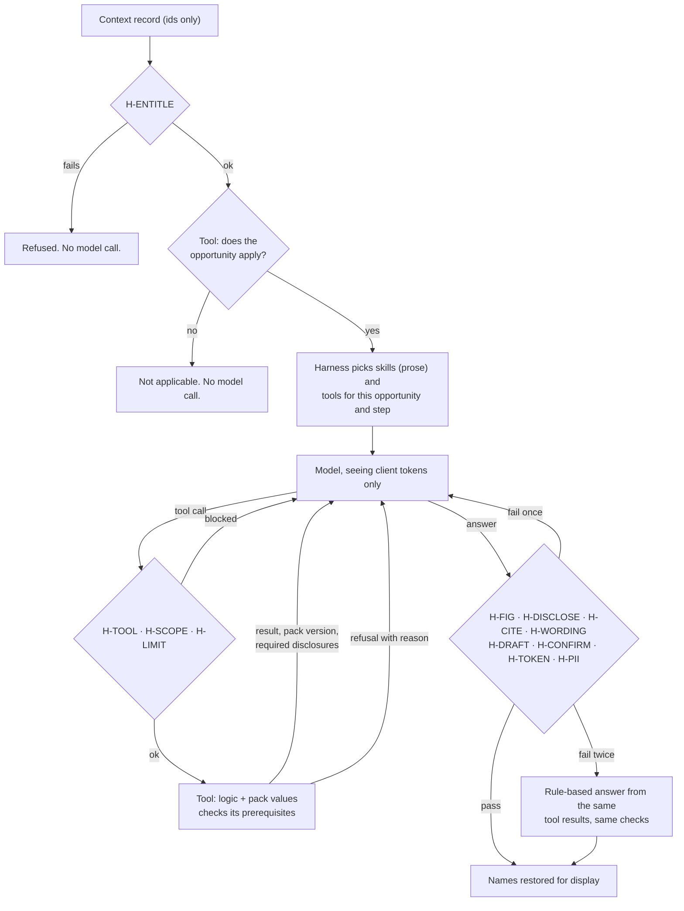

# Atlas proof of concept, restructured into four layers

This replaces `poc/skills-driven`, which mixed values, logic and guardrails into skill
folders. Here each kind of thing has one home, following the split in "Atlas POC: the rules
we used".

| Layer | Holds | Changed by | Lives in |
| --- | --- | --- | --- |
| 1. Policy pack | Every number, the strategy catalog and its availability requirements, disclosure wording. Versioned. | CIO office, product specialists, compliance | `policy/atlas-policy.yaml` |
| 2. Tools | The logic, as code. Reads values from the pack. Enforces its own prerequisites. Says which disclosures a result requires. | Engineering | `atlas/tools/` |
| 3. Skills | Procedure and judgment, as prose: step order, how to explain each eligibility outcome, when to offer the strategy comparison. | Product, with compliance review | `skills/` |
| 4. Harness | Entitlements, tool allow-list per screen, the answer checks, tokenizing, fallback. Knows no opportunity's rules. | Engineering, security, compliance | `atlas/harness/`, `harness/harness.yaml` |

## Checked against the prototype

The tools reproduce the prototype's own results on its 37 synthetic households:

| Tool | Compared | Result |
| --- | --- | --- |
| 13 opportunity criteria | Flag and amount shown | 37/37 for each |
| Household ranking and heat | Order and step of every opportunity | 37/37 |
| Advisory eligibility | Status and condition owners | 37/37 |
| Strategy availability | Reason text for each of 11 strategies | 13/13 households |
| Strategy fit and score | To nine decimal places, plus "same as default" | 13/13 |
| Strategy order and three suggestions | Exact | 13/13 |

Strategy analytics inputs (overlap, tracking error, sector gap, tax now) are the values the
prototype computed, exported as data. This POC ports the scoring, sorting and suggestion
logic, not the analytics behind them.

## What moved, compared with `poc/skills-driven`

| Was in a skill folder | Now |
| --- | --- |
| `business.yaml` `params` (thresholds, minimums) | Policy pack |
| `business.yaml` `criteria` (rule expressions run by a generic engine) | Tool code, one function per criterion |
| Made-up additive strategy weights | The prototype's method in a tool; its weights in the pack |
| `legal.yaml` universal rules (figures, citations, confirmations) | Harness |
| `legal.yaml` situation rules (Form CRS, pre-clearance, wash-sale) | Tool returns the disclosure id; pack holds the wording; harness checks it appears |
| `technical.yaml` tools per step | Harness configuration |
| `SKILL.md` | Stays, rewritten as procedure and judgment with no values |

## The one decision this makes visible

A specialist can change a **value** in the pack with no release. A new **kind of rule**
needs a tool change. The middle ground implemented here is strategy availability:

```yaml
- id: di
  requires: [{rule: min_brokerage, value: 250000, reason: "needs at least $250K"}]
```

The rule types (`taxable_only`, `min_brokerage`, `min_household_value`, `entity_in`,
`segment_in`) are code. Which strategy uses which type, with what value and what reason, is
data. A requirement using an unknown type is rejected when the pack is validated, with a
message saying a tool change is needed. If specialists need to add rule types themselves,
that is the point to bring in a rule store.

## How the layers are kept apart

| Check | What fails |
| --- | --- |
| Skills lint | A skill containing a dollar amount, percentage, basis points or a day count; a skill folder with anything but `SKILL.md`; a reference to a tool that does not exist |
| Tools lint | A numeric literal in tool code other than 0, 1, -1 and rounding constants |
| Pack validation | Weights that do not add to 1, an unknown rule type, a disclosure whose text does not satisfy its own match, an unknown source |
| Harness config check | A screen that names a tool or skill that does not exist |
| Coverage gate | A harness rule with no red-team case |

## Tools enforce prerequisites

Skills describe the order of work, but tools do not rely on it.

| Call | Refused with |
| --- | --- |
| `strategy_fit`, `fee_estimate`, `transition_schedule`, `generate_proposal` under specialist review | `PREREQ-ELIGIBILITY` |
| Any of them for a strategy the household cannot have | `PREREQ-STRATEGY` |
| `transition_schedule` with a direct indexing strategy | `PREREQ-STRATEGY-TYPE` |
| `transition_schedule` with a budget not on the pack's list | `PREREQ-BUDGET` |
| `generate_proposal` without a confirmation reference issued by the app | `PREREQ-CONFIRMATION` |

A test wipes every skill's instructions and shows the refusals still happen.

## One turn



## Evals by layer

`python -m atlas.evals --changed <file>` runs only what the changed layer can affect.

| Changed | Runs |
| --- | --- |
| `policy/` | Pack validation, tool parity, agent cases. Attach `python -m atlas.impact key=value` to the change. |
| `atlas/tools/` | Tool parity, layer lint, agent cases |
| `skills/` | Layer lint, agent cases |
| `harness/` | Layer lint, agent cases, coverage |

Current state: 64 checks pass (1 pack, 19 parity, 3 lint, 9 flow, 13 red-team, 19 for the
lean flow); every harness rule is covered; 40 tests.

## The lean flow

`LEAN.md` describes three efficiency changes built on these layers and measured against the
flow above: decisions made once a night, fields fetched before the model is called, and the
app (not the model) writing figures, disclosures, citations and actions. Run
`python compare.py`.

## Run it

```bash
cd poc/layered
python demo.py
python -m atlas.evals
python -m atlas.impact opportunities.concentration.threshold=0.15
python -m atlas.impact eligibility.specialist_review_above=0.25
pytest -q
```

Python 3.11+, PyYAML, pytest. No network, no model.

## Where each section of the rules document landed

| Section | Policy pack | Tool | Skill | Harness |
| --- | --- | --- | --- | --- |
| 1. Opportunity criteria, ranking, heat | All values | `opportunities.py` | `opportunity` (how to use the result) | |
| 2. Eligibility | Review share, condition owners | `eligibility.py` | `advisory` (how to explain each outcome) | |
| 3. Routing each holding | not in this POC | not in this POC | | |
| 4. Fee and cost | not in this POC | `fee_estimate` stub | | |
| 5. Strategy ranking | Weights, floors, catalog, requirements | `strategies.py` | `strategy-comparison` | |
| 6. Transition model | Budgets, excluded types | `transition_schedule` stub with real prerequisites | | |
| 7. Answer rules | Disclosure wording | Which disclosures apply | | H-FIG, H-CITE, H-CONFIRM, H-ENTITLE |
| 8. Guardrails | | | | Checks 1, 2, 7, 8, 9, 10 |

## What is not here

- **Sections 3, 4 and 6 are not ported.** Routing, fees and the transition schedule stay with
  the prebuilt tools; only their prerequisites are implemented.
- **Guardrail checks 3 to 6 are not implemented:** field-level policy, free-text scanning,
  hidden instructions in retrieved text, and the payload leak test. Tokenizing here covers
  the household id only.
- **The model is a stand-in.** Red-team cases show a rule catches a known failure, not how
  often a real model produces one.
- **The "suggested next step" text per criterion** from section 1 is not included. It is
  governed wording with values in it, so it belongs in the pack as templates.
- **The 90-day downgrade window** is recorded in the pack but applied upstream, where facts
  are built, so changing it here has no effect in this POC.
- **Pack values are the prototype's**, marked `status: illustrative`.

## One correction to the rules document

Section 1 says the concentration amount shown is "the amount above 10%". The prototype has
two figures. The Book view shows the full value of the positions over the threshold. The
household tile sizes its heat by the amount above the threshold. The tool returns both
(`amount` and `amount_above_threshold`), and a test pins the difference.
